# Placing Sheet Pipeline (`--only-sheet 2`)

This document details the real, ordered execution flow of the Tekla 2D drawing placing pipeline for **Sheet 2** (`SheetRole.Placing`), from command-line invocation to final PDF export.

---

## 1. Pipeline Overview & Command-Line Invocation

A standard placing sheet run is invoked via:
```bash
TeklaExtractor.exe --civil-drawings --mark W10-78 --only-sheet 2 --clean-mark --no-booklet --run-tag place-b5
```
Or for diagnostic/understanding runs:
```bash
TeklaExtractor.exe --civil-drawings --mark W10-78 --only-sheet 2 --clean-mark --placing-dryrun
TeklaExtractor.exe --civil-drawings --mark W10-78 --only-sheet 2 --stage-census --stage-snapshots
```

### Key Controlling Flags
| Flag | Scope & Effect |
|---|---|
| `--only-sheet 2` | Restricts extraction, macro creation, cleanup, and export strictly to Sheet 2 (`SheetRole.Placing` / `CU REINF. PLACING`). |
| `--clean-mark` | Deletes the existing piece's sheet 2 from the Tekla database before running macros, triggering a fresh macro rebuild. |
| `--placing-dryrun` | Traverses model reinforcement and evaluates proposed chains without altering drawing dimensions or callouts; post-processing stages are skipped. |
| `--placing-rebuild-only` | Rebuilds END 2 and VIEW A dimensions and layouts, but skips purge, TOP IN FORM rebar callouts, and BBS comparison. |
| `--stage-census` | Logs object counts by C# type per view and writes detailed point/extent/text census and diffs to `Export/stage_census.csv`. |
| `--stage-snapshots` | Exports vector PDF snapshots of the active drawing after the macro and after each CleanPlacing stage into `Export/stages/NN_stagename.pdf`. |
| `--skip-pdf` | Skips final PDF generation in `Export/CivilDrawings/.../PDF/`. |

---

## 2. Real Ordered Execution Flow (Step-by-Step)

The following sequence reflects the exact execution path recorded in production logs (`dry1.log`, `place-b5.log`).

```mermaid
flowchart TD
    CLI["1. CLI & Flags Parsing<br/>(Program.RunCivilDrawings)"] --> ModelConn["2. ModelReader & Pre-flight<br/>(ModelReader.Connect)"]
    ModelConn --> SheetClean{"3. Pre-clean Sheet 2?<br/>(--clean-mark)"}
    SheetClean -->|Yes| DeleteSheet["DeleteByMark<br/>(DrawingSheetCleaner)"]
    SheetClean -->|No| BatchInit["4. BatchExtractor Init<br/>(VerifyAndRepair)"]
    DeleteSheet --> BatchInit
    BatchInit --> MacroCheck{"5. Sheet 2 Exists?<br/>(LocalDrawingMacroRunner)"}
    MacroCheck -->|No / Rebuilt| RunMacro["RunMacro SP_M.CU_PG2_11X17.cs<br/>(Tekla Macro Engine)"]
    MacroCheck -->|Yes| SheetScan["6. Drawing Scan & Match<br/>(ExtractAllDrawings)"]
    RunMacro --> SheetScan
    SheetScan --> OpenSheet["7. Open Active Sheet<br/>(CaptureActiveSheet)"]
    OpenSheet --> BbsExtract["8. Rebar BBS Extract<br/>(RebarBbsExtractor.Extract)"]
    BbsExtract --> CPViews["9. CleanPlacing.views<br/>(FindViews, Classify, Scale)"]
    CPViews --> DryRunCheck{"Dry Run?<br/>(--placing-dryrun)"}
    DryRunCheck -->|Yes| ReportOnly["RebuildFromModel(apply:false)<br/>Write placing_report.txt & Exit"]
    DryRunCheck -->|No| CPPurge["10. CleanPlacing.purge<br/>(NuclearPurge, Park Junk/3D)"]
    CPPurge --> CPStations["11. CleanPlacing.stations<br/>(Layout Front, Axis, Buckets)"]
    CPStations --> CPTiers["12. CleanPlacing.tiers<br/>(2-Tier Dims, Overall, Side A/B)"]
    CPTiers --> CPEnd["13. CleanPlacing.end<br/>(Layout END 2, Remove Junk)"]
    CPEnd --> CPViewA["14. CleanPlacing.viewA<br/>(Layout VIEW A, RebuildFromModel)"]
    CPViewA --> CPCombine["15. CleanPlacing.combine<br/>(NuclearPurge, Star * -> @)"]
    CPCombine --> CPRebar["16. CleanPlacing.rebar<br/>(AntiCollision Rebar Callouts)"]
    CPRebar --> CPBbs["17. CleanPlacing.bbs<br/>(Compare BBS, Font Sync)"]
    CPBbs --> CPCommit["18. CleanPlacing.commit<br/>(AssertBounds, CommitChanges, Save)"]
    CPCommit --> PDFGen["19. PDF Export<br/>(DrawingGenerator.ExportToPdf)"]
    PDFGen --> Final["20. Manifest & Coverage<br/>(CivilCoverageReporter)"]
```



---

### Step 1: Command-Line Parsing & Option Setup
- **Function**: [`Program.RunCivilDrawings`](file:///d:/Github/TeklaDrawings2D/src/Program.cs#L260)
- **File & Line**: [src/Program.cs:260](file:///d:/Github/TeklaDrawings2D/src/Program.cs#L260)
- **Inputs**: CLI argument array `args`.
- **Flag**: Always runs as entry point.
- **Creates / Deletes / Moves**: None.
- **Typical Time**: ~10 ms.

---

### Step 2: Model Connection & Stale Numbering Check
- **Function**: [`ModelReader.Connect`](file:///d:/Github/TeklaDrawings2D/src/ModelReader.cs#L51), [`PrecastDimensionPostProcessor.AbortIfNumberingStale`](file:///d:/Github/TeklaDrawings2D/src/Drawings/PrecastDimensionPostProcessor.cs#L1218)
- **File & Line**: [src/Program.cs:299](file:///d:/Github/TeklaDrawings2D/src/Program.cs#L299), [src/ModelReader.cs:51](file:///d:/Github/TeklaDrawings2D/src/ModelReader.cs#L51), [src/Drawings/PrecastDimensionPostProcessor.cs:1218](file:///d:/Github/TeklaDrawings2D/src/Drawings/PrecastDimensionPostProcessor.cs#L1218)
- **Inputs**: Tekla Remoting connection, `Tekla.Structures.Model.Model`.
- **Flag**: Bypassed if `--extract-only`.
- **Creates / Deletes / Moves**: None.
- **Typical Time**: ~150 – 330 ms.

---

### Step 3: Sheet Deletion (`--clean-mark`)
- **Function**: [`DrawingSheetCleaner.DeleteByMark`](file:///d:/Github/TeklaDrawings2D/src/Drawings/DrawingSheetCleaner.cs#L51)
- **File & Line**: [src/Program.cs:325](file:///d:/Github/TeklaDrawings2D/src/Program.cs#L325), [src/Drawings/DrawingSheetCleaner.cs:51](file:///d:/Github/TeklaDrawings2D/src/Drawings/DrawingSheetCleaner.cs#L51)
- **Inputs**: Piece mark `W10-78`, `onlySheet = 2`.
- **Flag**: Controlled by `--clean-mark` (or `--delete-existing`).
- **Creates / Deletes / Moves**:
  - **Deletes**: Existing Tekla Drawing object matching `W10-78 - 2` / `CU REINF. PLACING`.
- **Typical Time**: ~100 – 300 ms.

---

### Step 4: Batch Extractor Initialization & Pre-flight
- **Function**: [`CivilDrawingBatchExtractor.Run`](file:///d:/Github/TeklaDrawings2D/src/Civil/CivilDrawingBatchExtractor.cs#L80), [`CivilDrawingSupport.Preflight`](file:///d:/Github/TeklaDrawings2D/src/Civil/CivilDrawingSupport.cs#L50), [`AttributeFilesVerifier.VerifyAndRepair`](file:///d:/Github/TeklaDrawings2D/src/Civil/AttributeFilesVerifier.cs#L24)
- **File & Line**: [src/Civil/CivilDrawingBatchExtractor.cs:80](file:///d:/Github/TeklaDrawings2D/src/Civil/CivilDrawingBatchExtractor.cs#L80)
- **Inputs**: Output folder path `Export/CivilDrawings/new with macros`.
- **Flag**: Always runs.
- **Creates / Deletes / Moves**: None.
- **Typical Time**: ~200 – 300 ms.

---

### Step 5: Macro Execution (`macro-PG2`)
- **Function**: [`LocalDrawingMacroRunner.RunMacros`](file:///d:/Github/TeklaDrawings2D/src/Drawings/LocalDrawingMacroRunner.cs#L96) $\rightarrow$ [`RunMacroInBatches`](file:///d:/Github/TeklaDrawings2D/src/Drawings/LocalDrawingMacroRunner.cs#L180)
- **File & Line**: [src/Civil/CivilDrawingBatchExtractor.cs:191](file:///d:/Github/TeklaDrawings2D/src/Civil/CivilDrawingBatchExtractor.cs#L191), [src/Drawings/LocalDrawingMacroRunner.cs:96](file:///d:/Github/TeklaDrawings2D/src/Drawings/LocalDrawingMacroRunner.cs#L96)
- **Inputs**: Model part selection, Tekla script `SP_M.CU_PG2_11X17.cs`.
- **Flag**: Controlled by `--only-sheet 2` + `--clean-mark` (or when Sheet 2 is missing). Bypassed by `--skip-macros`.
- **Creates / Deletes / Moves**:
  - **Creates**:
    - Tekla Drawing: `W10-78 - 2` (`CU REINF. PLACING`).
    - Views:
      - `TOP IN FORM` (FrontView, elevation)
      - `END 2` (BottomView, bottom section)
      - `VIEW A` / `A-A` (SectionView, cross section)
      - Iso/3D view (parked)
      - Detail views (e.g. `SP25`)
    - Graphic Objects: `Part`, `ReinforcementGroup`, `ReinforcementSingle`, `Connection`, `Surfacing`, `ReferenceModel`, `StraightDimensionSet`, `StraightDimension`, `Mark`, `MarkSet`, `LeaderLine`, `Text`.
- **IDENTITY LOSS POINT**:
  - Dimensions and marks generated by the Tekla macro are unlinked native drawing objects: `StraightDimensionSet` has no pointer to model rebar.
  - Marks often have broken references or `?` glyphs before post-processing.
- **Typical Time**: ~15,000 – 25,000 ms (~15 – 25 s).

---

### Step 6: Drawing Discovery & Role Resolution
- **Function**: [`CivilDrawingBatchExtractor.ExtractAllDrawings`](file:///d:/Github/TeklaDrawings2D/src/Civil/CivilDrawingBatchExtractor.cs#L281), [`SheetRoleMap.MatchesOnlySheet`](file:///d:/Github/TeklaDrawings2D/src/Civil/SheetRoleMap.cs#L121)
- **File & Line**: [src/Civil/CivilDrawingBatchExtractor.cs:281](file:///d:/Github/TeklaDrawings2D/src/Civil/CivilDrawingBatchExtractor.cs#L281), [src/Civil/SheetRoleMap.cs:121](file:///d:/Github/TeklaDrawings2D/src/Civil/SheetRoleMap.cs#L121)
- **Inputs**: Model drawing catalog enumerator.
- **Flag**: Filtered by `--only-sheet 2` and `--mark W10-78`.
- **Creates / Deletes / Moves**: None.
- **Typical Time**: ~50 – 150 ms.

---

### Step 7: Drawing Open & Sheet Capture
- **Function**: [`CivilDrawingSupport.CaptureActiveSheet`](file:///d:/Github/TeklaDrawings2D/src/Civil/CivilDrawingSupport.cs#L228), [`DrawingHandler.SetActiveDrawing`](file:///d:/Github/TeklaDrawings2D/src/Civil/CivilDrawingSupport.cs#L235)
- **File & Line**: [src/Civil/CivilDrawingBatchExtractor.cs:427](file:///d:/Github/TeklaDrawings2D/src/Civil/CivilDrawingBatchExtractor.cs#L427), [src/Civil/CivilDrawingSupport.cs#L228](file:///d:/Github/TeklaDrawings2D/src/Civil/CivilDrawingSupport.cs#L228)
- **Inputs**: Drawing `[W10-78 - 2]`.
- **Flag**: Always runs for matched sheets.
- **Creates / Deletes / Moves**: None (activates sheet in memory).
- **Typical Time**: ~800 – 2,100 ms.

---

### Step 8: Rebar BBS Data Extraction
- **Function**: [`RebarBbsExtractor.Extract`](file:///d:/Github/TeklaDrawings2D/src/Civil/Extractors/RebarBbsExtractor.cs#L40)
- **File & Line**: [src/Civil/CivilDrawingBatchExtractor.cs:462](file:///d:/Github/TeklaDrawings2D/src/Civil/CivilDrawingBatchExtractor.cs#L462)
- **Inputs**: Active drawing, model reinforcement objects.
- **Flag**: Standard extractor pass.
- **Creates / Deletes / Moves**: Writes rows to `REBAR_BBS.csv`. Drawing untouched.
- **Typical Time**: ~800 – 2,100 ms.

---

### Step 9: `CleanPlacing.views` (Classification & Scale)
- **Function**: [`PrecastDimensionPostProcessor.CleanPlacingCore`](file:///d:/Github/TeklaDrawings2D/src/Drawings/PrecastDimensionPostProcessor.cs#L8203)
- **File & Line**: [src/Drawings/PrecastDimensionPostProcessor.cs:8208](file:///d:/Github/TeklaDrawings2D/src/Drawings/PrecastDimensionPostProcessor.cs#L8208)
- **Inputs**: Drawing `[W10-78 - 2]`, `sheet`, `part`.
- **Flag**: Controlled by role `Placing` or `IsPlacingSheet(drawing)`.
- **Sub-methods**:
  - `EnsureDimFont`: verifies Arial Narrow 1.8mm.
  - `FindSheetViews`, `PromotePlacingViews`, `ForceClassifyPlacingViews`:
    - `front` $\rightarrow$ `TOP IN FORM`
    - `bottom` $\rightarrow$ `END 2`
    - `section` $\rightarrow$ `VIEW A`
  - `CountStraightDimensionSets`: counts native dims (e.g. elev=4, END2=27, VIEW_A=21).
  - `SelectPlacingScale`: computes scale 1:50 from live model length (5120 mm) vs available width.
- **Stage Audit Point**:
  - `00_macro`: Records initial post-macro census & snapshot.
  - `01_views`: Records classified views state.
- **Dry-run Escape**:
  - If `--placing-dryrun`: calls `RebuildFromModel(apply: false)`, writes `placing_report.txt`, and exits!
- **Creates / Deletes / Moves**: Classifies view variables. Drawing graphics unmodified.
- **Typical Time**: ~105,000 – 139,000 ms (~1.5 – 2.3 min; enumerates 700+ drawing objects and model solids).

---

### Step 10: `CleanPlacing.purge` (Nuclear Purge & Parking)
- **Function**: [`NuclearPurgeLeftDumpOnly`](file:///d:/Github/TeklaDrawings2D/src/Drawings/PrecastDimensionPostProcessor.cs#L10237), [`PurgeAllViewDimensions`](file:///d:/Github/TeklaDrawings2D/src/Drawings/PrecastDimensionPostProcessor.cs#L7785), [`ParkViewOffSheet`](file:///d:/Github/TeklaDrawings2D/src/Drawings/PrecastDimensionPostProcessor.cs#L7770)
- **File & Line**: [src/Drawings/PrecastDimensionPostProcessor.cs:8265](file:///d:/Github/TeklaDrawings2D/src/Drawings/PrecastDimensionPostProcessor.cs#L8265)
- **Inputs**: `sheet`, `sheetWidth = 431.8`, `sheetHeight = 279.4`.
- **Flag**: Controlled by `!PlacingRebuildOnly`.
- **Creates / Deletes / Moves**:
  - **Deletes**: `StraightDimensionSet` and `StraightDimension` objects located outside margins ($X < 10$ or outside paper border).
  - **Deletes**: All dimensions in junk views (`SP25`).
  - **Moves**: Detail views (`SP25`) and `view3D` moved off-sheet to park coordinates ($X \ge 20000, Y \ge 1000$).
- **Stage Audit Point**: `02_purge`.
- **Typical Time**: ~52,000 ms (~52 s).

---

### Step 11: `CleanPlacing.stations` (Elevation Layout & Stations)
- **Function**: [`ApplyPlacingViewLayout`](file:///d:/Github/TeklaDrawings2D/src/Drawings/PrecastDimensionPostProcessor.cs#L7820), [`ReseatPlacingFront`](file:///d:/Github/TeklaDrawings2D/src/Drawings/PlacingModelRebuild.cs#L45), [`PanelAxis.Measure`](file:///d:/Github/TeklaDrawings2D/src/Drawings/PrecastElevationRows.cs#L40), [`CollectStations`](file:///d:/Github/TeklaDrawings2D/src/Drawings/PrecastDimensionPostProcessor.cs#L4300), [`PurgeIsolatedAndStaleChains`](file:///d:/Github/TeklaDrawings2D/src/Drawings/PrecastDimensionPostProcessor.cs#L8480), [`CombineNativeChains`](file:///d:/Github/TeklaDrawings2D/src/Drawings/PrecastDimensionPostProcessor.cs#L8620)
- **File & Line**: [src/Drawings/PrecastDimensionPostProcessor.cs:8294](file:///d:/Github/TeklaDrawings2D/src/Drawings/PrecastDimensionPostProcessor.cs#L8294)
- **Inputs**: `front` view, `part`, `scale = 50`.
- **Flag**: Controlled by `!PlacingRebuildOnly` (layout always applies).
- **Creates / Deletes / Moves**:
  - **Moves**: `TOP IN FORM` view origin set to `(elevCenterX, elevCenterY)`, scale set to 1:50.
  - **Deletes**: Stale full-span and isolated chains from `front`.
  - **Modifies**: Combines adjacent collinear native dimension sets.
- **Stage Audit Point**: `03_stations`.
- **Typical Time**: ~8,300 ms (~8.3 s).

---

### Step 12: `CleanPlacing.tiers` (Two-Tier Dimensions on Elevation)
- **Function**: [`PlacePlacingTwoTierElevDims`](file:///d:/Github/TeklaDrawings2D/src/Drawings/PrecastDimensionPostProcessor.cs#L8800), [`SealView`](file:///d:/Github/TeklaDrawings2D/src/Drawings/PrecastDimensionPostProcessor.cs#L5600), [`SyncTopInFormLabel`](file:///d:/Github/TeklaDrawings2D/src/Drawings/PrecastDimensionPostProcessor.cs#L7900)
- **File & Line**: [src/Drawings/PrecastDimensionPostProcessor.cs:8314](file:///d:/Github/TeklaDrawings2D/src/Drawings/PrecastDimensionPostProcessor.cs#L8314)
- **Inputs**: `front` view, `elevAxis`, `elevBuckets`, `scale = 50`.
- **Flag**: Skipped if `--placing-rebuild-only`.
- **Creates / Deletes / Moves**:
  - **Creates**:
    - Horizontal Row 1: Openings / notches tier (`StraightDimensionSet`).
    - Horizontal Row 2: Profile overall tier (`StraightDimensionSet`, e.g. 5119.9 mm).
    - Vertical Side A & Side B dimension sets (`StraightDimensionSet`, 6 pts and 3 pts).
  - **Modifies**: Title label `Text` set to `TOP IN FORM\n1:50`.
- **IDENTITY LOSS POINT**:
  - Newly generated `StraightDimensionSet` elements are created from model solid stations, replacing unlinked macro chains.
- **Stage Audit Point**: `04_tiers`.
- **Typical Time**: ~2,000 ms (~2 s).

---

### Step 13: `CleanPlacing.end` (END 2 Layout)
- **Function**: [`ApplyPlacingViewLayout`](file:///d:/Github/TeklaDrawings2D/src/Drawings/PrecastDimensionPostProcessor.cs#L7820), [`RemoveTextsMatching`](file:///d:/Github/TeklaDrawings2D/src/Drawings/PrecastDimensionPostProcessor.cs#L7800)
- **File & Line**: [src/Drawings/PrecastDimensionPostProcessor.cs:8326](file:///d:/Github/TeklaDrawings2D/src/Drawings/PrecastDimensionPostProcessor.cs#L8326)
- **Inputs**: `bottom` view (`END 2`), `part`, `scale = 50`.
- **Flag**: Always runs.
- **Creates / Deletes / Moves**:
  - **Moves**: `END 2` origin placed at bottom-left `(endCenterX, 68.0)`, scale set to 1:50.
  - **Deletes**: Junk text matching `"VIEW VIEW"`.
- **Stage Audit Point**: `05_end`.
- **Typical Time**: ~300 ms (~0.3 s).

---

### Step 14: `CleanPlacing.viewA` (VIEW A Positioning & Model Rebuild)
- **Function**: [`ApplyPlacingViewLayout`](file:///d:/Github/TeklaDrawings2D/src/Drawings/PrecastDimensionPostProcessor.cs#L7820), [`RebuildFromModel`](file:///d:/Github/TeklaDrawings2D/src/Drawings/PlacingModelRebuild.cs#L91), [`SyncViewScaleLabel`](file:///d:/Github/TeklaDrawings2D/src/Drawings/PrecastDimensionPostProcessor.cs#L7860)
- **File & Line**: [src/Drawings/PrecastDimensionPostProcessor.cs:8334](file:///d:/Github/TeklaDrawings2D/src/Drawings/PrecastDimensionPostProcessor.cs#L8334), [src/Drawings/PlacingModelRebuild.cs:91](file:///d:/Github/TeklaDrawings2D/src/Drawings/PlacingModelRebuild.cs#L91)
- **Inputs**: `bottom`, `section`, `front`, `sheet`, `part`, `scale = 50`.
- **Flag**: Always runs.
- **Sub-actions**:
  - Calculates `viewACenterX` from `END 2` solid maximum $X + 18\text{ mm} + 35\text{ mm}$ to guarantee zero overlap.
  - Moves `section` (`VIEW A`) view origin to `(viewACenterX, 83.0)`, scale set to 1:50.
  - `RebuildFromModel(apply: true)`:
    - Reads model reinforcement from model database.
    - Classifies bars into `END 2` (parallel to end normal) vs `VIEW A` (parallel to section normal).
    - Checks unlinked native macro dims (`kept native reason=unlink`).
    - Rebuilds chains and updates dimensions and callouts.
  - `SyncViewScaleLabel`: inserts explicit caption text `END 2\n1:50` and `VIEW A\n1:50`.
- **IDENTITY LOSS POINT**:
  - Native macro dimension sets on END 2 and VIEW A are treated as unlinked geometry (`kept native reason=unlink`).
- **Stage Audit Point**: `06_viewA`.
- **Typical Time**: ~31,500 ms (~31.5 s).

---

### Step 15: `CleanPlacing.combine` (Debris Purge & Star Rewrite)
- **Function**: [`NuclearPurgeLeftDumpOnly`](file:///d:/Github/TeklaDrawings2D/src/Drawings/PrecastDimensionPostProcessor.cs#L10237), [`RewriteCombinedStars`](file:///d:/Github/TeklaDrawings2D/src/Drawings/PrecastDimensionPostProcessor.cs#L8520)
- **File & Line**: [src/Drawings/PrecastDimensionPostProcessor.cs:8375](file:///d:/Github/TeklaDrawings2D/src/Drawings/PrecastDimensionPostProcessor.cs#L8375)
- **Inputs**: `sheet`, `front`, `bottom`, `section`.
- **Flag**: Skipped if `--placing-rebuild-only`.
- **Creates / Deletes / Moves**:
  - **Deletes**: Margin debris outside paper border.
  - **Modifies**: Rewrites text syntax from `*` to `@` (e.g. `4*794=3176` $\rightarrow$ `4@794=3176`).
- **Stage Audit Point**: `07_combine`.
- **Typical Time**: ~33,000 ms (~33 s).

---

### Step 16: `CleanPlacing.rebar` (Anti-Collision Callouts)
- **Function**: [`AntiCollisionEngine.PlaceRebarRuns`](file:///d:/Github/TeklaDrawings2D/src/Drawings/AntiCollisionEngine.cs#L40)
- **File & Line**: [src/Drawings/PrecastDimensionPostProcessor.cs:8382](file:///d:/Github/TeklaDrawings2D/src/Drawings/PrecastDimensionPostProcessor.cs#L8382)
- **Inputs**: `front` view, `part`, `scale = 50`, `CollectMarkTexts(front)`.
- **Flag**: Skipped if `--placing-rebuild-only`.
- **Creates / Deletes / Moves**:
  - **Creates**: Rebar callouts (`Text` and `LeaderLine`) placed in collision-free positions across the `TOP IN FORM` elevation (e.g. 17 callouts placed).
  - **Moves**: Adjusts existing leader lines and text positions away from solid geometry and dimension lines.
- **Stage Audit Point**: `08_rebar`.
- **Typical Time**: ~481,000 ms (~8 min; exhaustive spatial collision resolution).

---

### Step 17: `CleanPlacing.bbs` (BBS Verification & Font Sync)
- **Function**: [`PreflightQaChecker.CompareViewToBbs`](file:///d:/Github/TeklaDrawings2D/src/Civil/PreflightQaChecker.cs#L200), [`ApplyFontToStraightSets`](file:///d:/Github/TeklaDrawings2D/src/Drawings/PrecastDimensionPostProcessor.cs#L4400)
- **File & Line**: [src/Drawings/PrecastDimensionPostProcessor.cs:8386](file:///d:/Github/TeklaDrawings2D/src/Drawings/PrecastDimensionPostProcessor.cs#L8386)
- **Inputs**: `placingViews` (`front`, `bottom`, `section`), `part`, `_activePiece`.
- **Flag**: Skipped if `--placing-rebuild-only`.
- **Creates / Deletes / Moves**:
  - **Modifies**: Re-applies font Arial Narrow 1.8mm across all `StraightDimensionSet` and `Text` elements in all views.
- **Stage Audit Point**: `09_bbs`.
- **Typical Time**: ~39,000 ms (~39 s).

---

### Step 18: `CleanPlacing.commit` (Bounding Box Assertion & Database Save)
- **Function**: [`AssertSheetBounds`](file:///d:/Github/TeklaDrawings2D/src/Drawings/PrecastDimensionPostProcessor.cs#L9750), [`drawing.CommitChanges()`](file:///d:/Github/TeklaDrawings2D/src/Drawings/PrecastDimensionPostProcessor.cs#L8402), [`_handler.SaveActiveDrawing()`](file:///d:/Github/TeklaDrawings2D/src/Drawings/PrecastDimensionPostProcessor.cs#L8403), [`RefreshDrawingUi`](file:///d:/Github/TeklaDrawings2D/src/Drawings/PrecastDimensionPostProcessor.cs#L8405)
- **File & Line**: [src/Drawings/PrecastDimensionPostProcessor.cs:8397](file:///d:/Github/TeklaDrawings2D/src/Drawings/PrecastDimensionPostProcessor.cs#L8397)
- **Inputs**: Active drawing database.
- **Flag**: Always runs.
- **Creates / Deletes / Moves**:
  - Validates all visible objects are within $431.8 \times 279.4\text{ mm}$ borders.
  - Commits all in-memory changes into the Tekla drawing database file.
  - Flushes drawing save to disk.
- **Stage Audit Point**: `10_commit`.
- **Typical Time**: ~8,700 ms (~8.7 s).

---

### Step 19: PDF Export
- **Function**: [`DrawingGenerator.ExportToPdf`](file:///d:/Github/TeklaDrawings2D/src/Drawings/DrawingGenerator.cs#L319) $\rightarrow$ [`PrintDrawing`](file:///d:/Github/TeklaDrawings2D/src/Drawings/DrawingGenerator.cs#L564)
- **File & Line**: [src/Civil/CivilDrawingBatchExtractor.cs:521](file:///d:/Github/TeklaDrawings2D/src/Civil/CivilDrawingBatchExtractor.cs#L521), [src/Drawings/DrawingGenerator.cs:319](file:///d:/Github/TeklaDrawings2D/src/Drawings/DrawingGenerator.cs#L319)
- **Inputs**: Active drawing, destination path `Export/CivilDrawings/.../PDF/W10-78_-_3.pdf`.
- **Flag**: Bypassed if `--skip-pdf`.
- **Creates / Deletes / Moves**:
  - **Creates**: Final single-page vector PDF on disk via `TS PDF Writer`.
- **Typical Time**: ~5,500 – 11,000 ms (~5.5 – 11 s).

---

### Step 20: Manifest & Coverage Finalization
- **Function**: [`CivilCoverageReporter.Write`](file:///d:/Github/TeklaDrawings2D/src/Civil/CivilCoverageReporter.cs#L25), [`CivilHtmlReview.WriteFolderIndex`](file:///d:/Github/TeklaDrawings2D/src/Civil/CivilHtmlReview.cs#L20)
- **File & Line**: [src/Civil/CivilDrawingBatchExtractor.cs:253](file:///d:/Github/TeklaDrawings2D/src/Civil/CivilDrawingBatchExtractor.cs#L253)
- **Creates / Deletes / Moves**: Writes `coverage_report.txt`, `index.html`, and `manifest.json`.
- **Typical Time**: ~300 – 500 ms.

---

## 3. Points Where an Object Loses Its Identity

| Pipeline Location | Cause of Identity Loss | Impact on Downstream Stages |
|---|---|---|
| **Macro Output (`macro-PG2`)** | Tekla drawing macro generates `StraightDimensionSet` and `Mark` objects without `ModelIdentifier` or persistent link to individual reinforcement entities. | Post-processor cannot know which specific bar produced which dimension or mark; they appear as anonymous drawing geometry. |
| **`RebuildFromModel` (`viewA`)** | Dimension sets on END 2 and VIEW A are scanned. Because they lack model IDs, they are flagged `kept native reason=unlink`. | Pipeline must evaluate spatial geometry, tick counts, and extents rather than matching by ID. |
| **`PlaceRebarRuns` (`rebar`)** | Rebar callouts and leader lines are newly constructed from 3D model geometry stations, superseding macro marks. | Macro marks in `front` view are either masked, bypassed, or left unlinked. |
| **`NuclearPurgeLeftDumpOnly`** | Purge deletes objects by paper coordinate AABB ($X < 10\text{ mm}$ or outside border) regardless of object identity. | Any unlinked dimensions or texts pushed off-margin are deleted by location. |

---

## 4. Cross-Stage Dependency Matrix

| Stage | Consumes / Reads From | What It Depends On |
|---|---|---|
| **`macro-PG2`** | Pre-clean (`DeleteByMark`) | Requires clean drawing catalog when `--clean-mark` is used to prevent duplicate sheet suffix conflicts. |
| **`CleanPlacing.views`** | `macro-PG2` | Reads macro-created views; maps `front`, `bottom`, `section`; calculates sheet scale 1:50. |
| **`CleanPlacing.purge`** | `views` classification | Uses view bounds to identify junk detail views (`SP25`) and `view3D` to park off-sheet. |
| **`CleanPlacing.stations`** | `views` & model solid | Binds `PanelAxis` to `front` view; measures panel length; computes opening station buckets. |
| **`CleanPlacing.tiers`** | `stations` | Uses `elevBuckets.Openings` and `elevAxis.Span` to create horizontal 2-tier dimensions. |
| **`CleanPlacing.end`** | `views` | Uses classified `bottom` view to position `END 2` at bottom-left without crashing into border. |
| **`CleanPlacing.viewA`** | `end` & `stations` | Reads `bottom` (`END 2`) solid bounding box to calculate `viewACenterX`, ensuring VIEW A never overlaps END 2. |
| **`CleanPlacing.combine`** | `tiers` & `viewA` | Rewrites `*` to `@` across all newly created/rebuilt dimension sets. |
| **`CleanPlacing.rebar`** | `views` & `tiers` | Reads all existing text boxes on `front` view (`CollectMarkTexts`) to avoid collisions when placing rebar callouts. |
| **`CleanPlacing.bbs`** | `rebar` callouts | Verifies placed rebar marks against the 3D model BBS extraction. |
| **`CleanPlacing.commit`** | All prior stages | Runs final `AssertSheetBounds`, commits all database modifications to disk. |
| **`PDF Export`** | `commit` | Reads committed drawing database from disk to print the final PDF. |

---

## 5. Interaction: `--placing-dryrun` Combined with `--clean-mark`

When `--placing-dryrun` is combined with `--clean-mark`:
1. `--clean-mark` instructs `DrawingSheetCleaner.DeleteByMark` to delete any existing Sheet 2 from the Tekla database.
2. Because Sheet 2 no longer exists, `CivilDrawingBatchExtractor` invokes `LocalDrawingMacroRunner`, which executes `SP_M.CU_PG2_11X17.cs` to **rebuild a fresh sheet from scratch**.
3. The newly created sheet is opened and classified by `CleanPlacingCore`.
4. Because `PlacingDryRun` is true, `CleanPlacingCore` executes `RebuildFromModel(apply: false)` to audit model rebar chains and output `placing_report.txt`.
5. `CleanPlacingCore` then **returns immediately**, completely bypassing all post-processing stages (`purge`, `stations`, `tiers`, `end`, `viewA`, `combine`, `rebar`, `bbs`, `commit`).

> [!IMPORTANT]
> When combined with `--clean-mark`, `--placing-dryrun` does **not** leave the drawing catalog untouched: **the sheet was deleted and freshly rebuilt by the macro**, but **post-processing was skipped**. The resulting drawing on disk reflects raw macro output without post-processor corrections.
