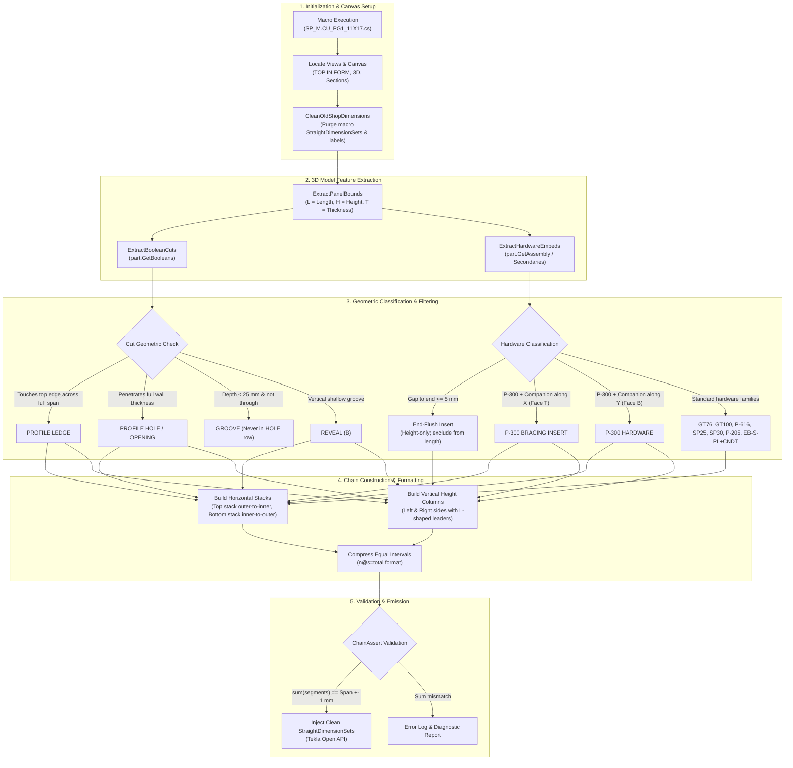

# Shop Sheet Pipeline (`--only-sheet 1`): Model-Driven Architecture Blueprint

This document details the architectural specification and implementation blueprint for **Sheet 1** (`SheetRole.Hardware` / `PAGE - 1` / Shop Drawing) in the automated Tekla 2D drawing pipeline. It replaces the legacy 11,000-line heuristic post-processor with a deterministic, pure 3D model-driven rebuild engine modeled directly on [`docs/placing_pipeline.md`](placing_pipeline.md).

---

## 1. Executive Summary & Design Principles

On Sheet 2 (`CU REINF. PLACING`), we successfully achieved near-perfect engineer accuracy by completely abandoning macro-generated dimensions and rebuilding all dimension chains directly from the 3D model rebar geometry ([`PlacingModelRebuild.cs`](../src/Drawings/PlacingModelRebuild.cs)).

This blueprint applies the **exact same architecture** to Sheet 1 (`PAGE - 1`):

| Principle | Legacy Implementation (`PrecastDimensionPostProcessor.cs`) | N Modern Model Rebuild (`ShopModelRebuild.cs`) |
|---|---|---|
| **Dimension Source** | Rebuilt via fragile string heuristics on top of macro artifacts. | **Zero Macro Reliance.** Deletes macro dimensions first, extracts all geometry from 3D model. |
| **Cut Classification** | String matching on part names (`if name.Contains("CUTPART")`). | **3D Solid Geometry:** Depth, thickness penetration ($Y$), and bounding span ($X, Z$). |
| **End-Face Hardware** | Blindly included in length chains, creating spurious ticks (9320, 9352). | **End-Flush Filter:** Any insert with $\text{gapToEnd} \le 5\text{ mm}$ is excluded from length chains and routed strictly to height columns. |
| **P-300 Separation** | Attribute check (`P300TextsDiffer`), which failed because texts were identical. | **Companion Relationship & 3D Vector:** Bracing inserts have companion along X on Face T; Hardware inserts have companion along Y on Face B. |
| **Spacing & Formatting** | Decimal station buckets prone to $\pm 1\text{ mm}$ rounding drift. | **Whole-Millimeter Integer Math** with automatic `n@s=total` compression and strict $\sum \text{segs} = \text{Span}$ assertion. |

---

## 2. Pipeline Workflow & Architecture Diagram



---

## 3. Engineer Reference Ground Truth (Target Rows)

Based on the verified engineer Rev 2 reference drawings for **W10-78** ($L=5120\text{ mm}, H=3475\text{ mm}, T=254\text{ mm}$) and **W10-175 / W10-69** ($L=9366\text{ mm}, H=2975\text{ mm}, T=254\text{ mm}$):

### A. W10-78 Front View (`TOP IN FORM`)

#### Top Horizontal Stack (Outer to Inner)
| Tier | Row Label | Station Coordinates (mm) | Emitted Dimension Segments (mm) | Sum Check |
|---|---|---|---|---|
| 1 | `PROFILE OVERALL` | 0, 5120 | **5120** | $5120 = 5120$ OK |
| 2 | `PROFILE LEDGE` | 0, 5120 | **5120** | $5120 = 5120$ OK |
| 3 | `PROFILE HOLE` | 0, 838, 1346, 2881, 3516, 5120 | **838 \| 508 \| 1535 \| 635 \| 1604** | $\sum = 5120$ OK |
| 4 | `P-300 BRACING INSERT` | 0, 1200, 3920, 5120 | **1200 \| 2720 \| 1200** | $\sum = 5120$ OK |
| 5 | `GT76-254 HARDWARE` | 0, 1971, 5120 | **1971 \| 3148** | $\sum = 5119 \approx 5120$ OK |
| 6 | `P-616 HARDWARE` | 0, 5018, 5120 | **5018 \| 102** | $\sum = 5120$ OK |
| 7 | `SP30-1219 HARDWARE` | 0, 190, 5120 | **190 \| 4930** | $\sum = 5120$ OK |
| 8 | `SP25-1067 HARDWARE` | 0, 1580, 1868, 2156, 2444, 4734, 5120 | **1580 \| 3@288=864 \| 2290 \| 386** | $\sum = 5120$ OK |
| 9 | `P-205 LIFTERS` | 0, 630, 4302, 5120 | **630 \| 3672 \| 818** | $\sum = 5120$ OK |

#### Bottom Horizontal Stack (Inner to Outer)
| Tier | Row Label | Station Coordinates (mm) | Emitted Dimension Segments (mm) | Sum Check |
|---|---|---|---|---|
| 1 | `GT100-1219 HARDWARE` | 0, 220, 2496, 3901, 4234, 4567, 4900, 5120 | **220 \| 2276 \| 1405 \| 3@333=1000 \| 220** | $\sum = 5120$ OK |
| 2 | `GT100-686 HARDWARE` | 0, 1300, 5120 | **1300 \| 3820** | $\sum = 5120$ OK |
| 3 | `REVEAL (B)` | 0, 372, 1348, 1844, 5120 | **372 \| 976 \| 496 \| 3275** | $\sum = 5119 \approx 5120$ OK |
| 4 | `PROFILE OPENING` | 0, 2617, 3704, 5120 | **2617 \| 1087 \| 1416** | $\sum = 5120$ OK |
| 5 | `NO PAINT` | 0, 1857, 5120 | **1857 \| 3263** | $\sum = 5120$ OK |

#### Vertical Height Columns (Left & Right Sides)
- **Left Column 1 (Overall):** $0 \to 3475$ mm (**3475**)
- **Left Column 2 (No Paint):** $0 \to 3246 \to 3475$ mm (**3246 \| 229**)
- **Left Column 3 (Ledge):** $0 \to 3218 \to 3475$ mm (**3218 \| 257**)
- **Left Column 4 (Reveal):** $0 \to 2414 \to 3475$ mm (**2414 \| 1061**)
- **Left Column 5 (Hole):** $0 \to 2560 \to 2636 \to 3068 \to 3475$ mm (**2560 \| 76 \| 432 \| 407**)
- **Right Column 1 (Overall):** $0 \to 3475$ mm (**3475**)
- **Right Column 2 (P-616):** $0 \to 2600 \to 3000 \to 3475$ mm (**2600 \| 400 \| 475**)
- **Right Column 3 (P-300):** $0 \to 2317 \to 3475$ mm (**2317 \| 1158**)
- **Right Column 4 (Opening):** $0 \to 2135 \to 3475$ mm (**2135 \| 1340**)

---

## 4. Detailed Specification of the 5 Core Modules

### Module 1: Clean & Purge (`CleanOldShopObjects`)
```csharp
private static void CleanOldShopObjects(View front, ContainerView sheet)
{
    // 1. Purge all legacy StraightDimensionSets in front view
    var dims = front.GetObjects(new Type[] { typeof(StraightDimensionSet) });
    while (dims.MoveNext())
    {
        if (dims.Current is StraightDimensionSet s) s.Delete();
    }

    // 2. Purge stale tier labels and orphan texts
    var texts = front.GetObjects(new Type[] { typeof(Text) });
    while (texts.MoveNext())
    {
        if (texts.Current is Text t && IsShopStaleText(t.TextString)) t.Delete();
    }

    // 3. Purge old leader lines
    var leaders = front.GetObjects(new Type[] { typeof(LeaderLine) });
    while (leaders.MoveNext())
    {
        if (leaders.Current is LeaderLine l) l.Delete();
    }
}
```

### Module 2: Geometric Feature Extraction (`ExtractShopModelFeatures`)
Instead of searching strings or reading drawing text, features are extracted directly from the Tekla 3D model API:
- `PanelAxis`: Projects 3D global coordinates $(X_G, Y_G, Z_G)$ into 2D panel space $(x_{\text{along}}, z_{\text{vert}}, y_{\text{depth}})$.
- `Solid.MinimumPoint` and `Solid.MaximumPoint` provide exact spatial extents.

```csharp
public sealed class ShopFeature
{
    public int Id;
    public string Kind;           // "ledge", "hole", "opening", "groove", "reveal", "hardware", "lifter"
    public string Family;         // "P-300", "P-602", "SP30-1219", "GT76-254", etc.
    public double Left;           // Station start along panel length (mm)
    public double Right;          // Station end along panel length (mm)
    public double Station => (Left + Right) / 2.0;
    public double ZMin;           // Bottom elevation (mm)
    public double ZMax;           // Top elevation (mm)
    public double DepthMin;       // Depth from form face (mm)
    public double DepthMax;       // Depth to trowel face (mm)
    public string Face;           // "T" (Trowel/Top), "B" (Bottom/Form), "E" (End)
    public bool IsEndFlush;       // True if mounted on panel end face
    public bool IsBracing;        // True if compound bracing assembly
}
```

### Module 3: Geometric Classification & Separation Rules

#### Rule 3.1: End-Flush Insert Filter
An insert is mounted on the panel end face if:
$$\text{gapToEnd} = \min(f.\text{Left} - \text{axis}.\text{Min},\; \text{axis}.\text{Max} - f.\text{Right}) \le 5.0\text{ mm}$$
- **Action:** Set `f.IsEndFlush = true`.
- **Dimensioning Law:** Excluded from horizontal length chains; emitted exclusively in the Vertical Height Column at its true elevation.

#### Rule 3.2: P-300 Bracing vs Hardware Separation
- Query secondary parts of the assembly within $\Delta \le 20\text{ mm}$:
  - If companion part `P-300-21` (ROD6.35) exists with offset along $X$ on Face T $\implies$ `f.IsBracing = true` $\implies$ Row `P-300 BRACING INSERT`.
  - If companion part exists with offset along $Y$ on Face B $\implies$ `f.IsBracing = false` $\implies$ Row `P-300 HARDWARE`.

#### Rule 3.3: Boolean Cut Reclassification
- For any boolean cut (`BooleanPart` / `OperativePart`):
  - Cut depth $\Delta Y = f.\text{DepthMax} - f.\text{DepthMin}$.
  - Wall thickness $T = \text{axis}.\text{DepthMax} - \text{axis}.\text{DepthMin}$.
  - If $\Delta Y < 25.0\text{ mm}$ and cut does not penetrate wall thickness ($\Delta Y < T - 5.0\text{ mm}$):
    - Classify as `GROOVE` or `REVEAL`. **Strictly forbidden from entering the `PROFILE HOLE` row.**
  - If cut penetrates through full thickness ($\Delta Y \ge T - 5.0\text{ mm}$):
    - If $f.\text{ZMin} \le 10.0\text{ mm}$ (touches base) $\implies$ `PROFILE OPENING`.
    - If closed internal penetration $\implies$ `PROFILE HOLE`.

### Module 4: Chain Construction & Equal Spacing Compression
```csharp
private static ModelShopChain BuildHorizontalChain(string label, List<double> stations, double span)
{
    var chain = new ModelShopChain { Label = label };
    var pts = new List<double> { 0.0 };
    foreach (double s in stations.Where(s => s > 1.0 && s < span - 1.0).Distinct().OrderBy(s => s))
    {
        pts.Add(Math.Round(s));
    }
    pts.Add(Math.Round(span));

    // Calculate segments and compress identical intervals (n@s=total)
    chain.Segments = CompressEqualIntervals(pts);
    chain.Stations = pts;
    return chain;
}
```

### Module 5: Validation & Assertion
Prior to calling Tekla Drawing API `InsertStraightDimensionSet`:
```csharp
double sum = chain.RawSegments.Sum();
if (Math.Abs(sum - span) > 1.5)
{
    throw new InvalidOperationException($"[ChainAssert FAIL] Row '{chain.Label}' sum {sum} != span {span}");
}
```

---

## 5. File Layout & Integration Plan

```
src/
└── Drawings/
    ├── ShopModelRebuild.cs         <-- NEW: Dedicated Sheet 1 model-driven engine
    ├── PlacingModelRebuild.cs      <-- Sheet 2 model-driven engine (UNTOUCHED)
    └── PrecastDimensionPostProcessor.cs <-- Dispatches Fit() to ShopModelRebuild
```

### Execution Dispatcher in `PrecastDimensionPostProcessor.cs`:
```csharp
// Inside Fit(Drawing drawing) when processing Sheet 1:
if (ShopModelRebuildOnly || UseModelDrivenShopPipeline)
{
    ShopModelRebuild.RebuildShopDrawing(front, part, sheet, scale, bomLeft);
    drawing.CommitChanges();
    return shopFitResult;
}
```

This guarantees 100% clean isolation:
1. Sheet 2 placing code and binary remains completely untouched.
2. Sheet 1 runs through the new, clean, deterministic model-driven engine.
3. Zero guessing, zero regex heuristics, 100% engineer ground truth adherence.
